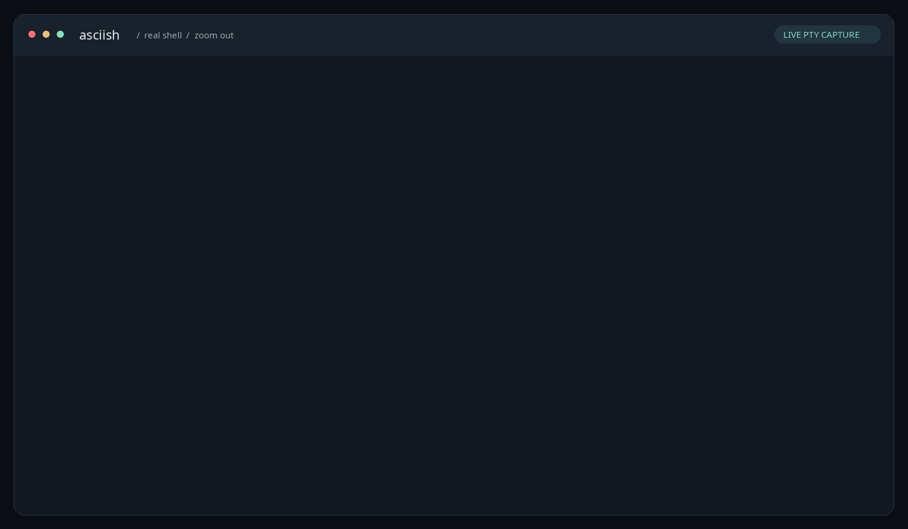

# asciish

Your actual shell. Unreasonably large.



Every character becomes a 5×7 ASCII glyph made from copies of itself. An `A`
is made of `A`s. A `$` is made of `$`s. Your commands still run. Zoom your
terminal out until the shell fits.

Made for [@cafkafk on Bluesky](https://bsky.app/profile/cafkafk.bsky.social).

## Run it

You need Python 3.10 or newer and an ANSI terminal on Linux, macOS, or WSL.

```sh
git clone https://github.com/NoahWLono/asciish.git
cd asciish
./run.sh
```

The first run creates `.venv` inside the checkout and downloads the Python
dependencies. Subsequent runs use that environment. It starts `$SHELL`, with
your normal shell configuration; if `$SHELL` is unset, it uses your account's
login shell.

Use your terminal's **Zoom Out** shortcut repeatedly, or choose a very small
font in its settings. Each shell cell occupies **6 columns × 8 rows**. An
80×24 shell therefore needs a 481×193 terminal, including the status line.
Resizing the window or changing font size updates the child shell immediately.
A regular-sized terminal works too; you just get a very small shell viewport.

Type `exit` or press **Ctrl-D** at an empty shell prompt to leave. **Ctrl-]**
is the emergency exit, including while a command is running. **Ctrl-C** goes
to the command, as usual.

Already use pipx?

```sh
pipx install git+https://github.com/NoahWLono/asciish.git
asciish
```

## Options

```sh
./run.sh -- /bin/bash --noprofile --norc  # a clean Bash session
./run.sh -- fish                        # or another shell
./run.sh -- python3                     # a real Python REPL
./run.sh --no-color                     # monochrome output
./run.sh --ink '#'                      # use one character for every glyph
./run.sh --preview 'hello, cafkafk!'     # static ASCII, also works in pipes
```

`NO_COLOR` also disables colors. Arguments after `--` are passed directly to
the child program. Commands inside the session execute on your machine with
your normal permissions.

`--preview` accepts plain text: tabs expand to eight-column stops, and control
characters use visible fallback glyphs.

## What works

- A real controlling PTY: line editing, history, tab completion, Ctrl-C, and
  shell job control.
- ANSI colors, 256-color and RGB output, bold and reverse video.
- Cursor movement, erasing, scrolling regions, alternate screen buffers, and
  terminal status queries.
- Terminal resizing and restoration on normal exit, failed commands, and
  handled termination signals. The wrapper returns the child's exit status.
- All 95 printable ASCII characters, with distinct uppercase and lowercase
  glyphs. Accented Latin text is normalized where possible; box drawing gets
  ASCII approximations; unsupported Unicode becomes `?`.

The terminal parser is [pyte](https://github.com/selectel/pyte). This is a small
terminal emulator with a deliberately ridiculous display. It does not support
every xterm feature: mouse reporting, image protocols, clickable hyperlinks,
and full Unicode glyph rendering are outside its scope. Host scrollback does
not contain the inner shell's history. Full-screen programs can need much more
space than a shell prompt.

## Development

```sh
python3 -m venv .venv
.venv/bin/python -m pip install -e '.[dev,demo]'
.venv/bin/python -m pytest
.venv/bin/python -m build
```

The tests include actual nested PTY sessions for sizing, signal handling,
shell interaction, and terminal restoration, plus renderer and parser tests.
GitHub Actions runs the suite on Linux and macOS.

The demo is captured from a running shell, then rasterized from its terminal
output. To regenerate the GIF, PNG, and asciinema recording (requires Bash):

```sh
.venv/bin/python tools/record_demo.py
```

You can also play [the recording](assets/demo.cast) with
`asciinema play assets/demo.cast`.

MIT licensed. The bitmap font was drawn for this project.
